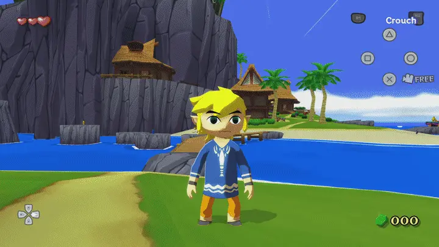
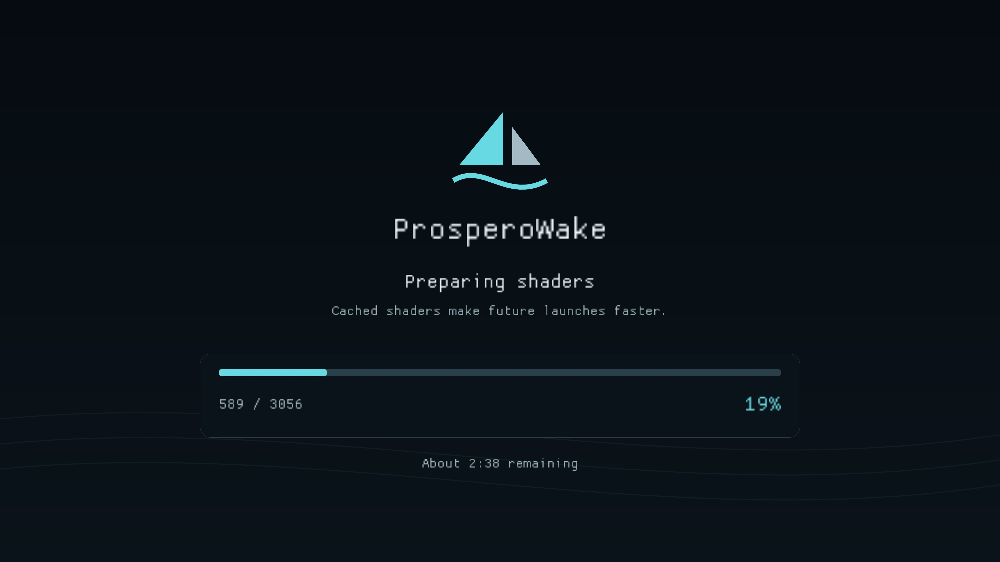
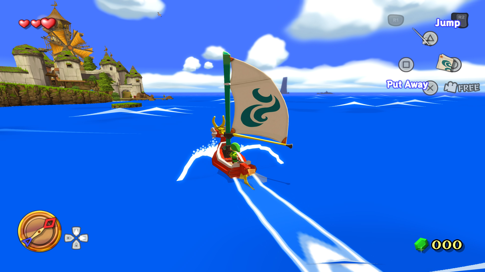

<p align="center">
  
</p>

<h1 align="center">ProsperoWake</h1>

<p align="center"><strong>The Wind Waker, native on PlayStation 5.</strong><br>
4K output · HD textures · Swift sailing · PlayStation controls</p>

ProsperoWake is an independently maintained PS5 port of **The Legend of Zelda: The Wind Waker**,
forked from [PS5_SwitchWaker](https://github.com/griches/PS5_SwitchWaker),
and built on [SwitchWaker](https://github.com/centollOS/SwitchWaker), with improvements
adapted from [Bluewake](https://github.com/chrissotraidis/bluewake) and
[Better Wind Waker](https://github.com/WideBoner/betterww).
Plays both USA and PAL game images, with PlayStation button prompts
and an options menu designed for the DualSense. This project targets PS5 only.

For HD textures, we recommend **[Henriko Magnifico’s Wind Waker 4K](https://www.henrikomagnifico.com/wind-waker-4k)**.
The texture pack is downloaded separately. You supply your own game image.

## Features

### Graphics

- **4K and widescreen** — 1080p, 1440p and 4K output; 16:9 or original 4:3.
- **Interpolated 60 fps** — smoother motion with the original 30 fps game logic. A 30 fps mode is also available.
- **HD textures** — full-resolution texture packs, with an optional size limit.
- **Resolution controls** — choose output and internal rendering resolution independently.
- **Lighting** — ambient occlusion, wind-driven cloud shadows, sun-facing edge light and torch light.
- **Post-processing** — colour grading, FXAA, sharpening, soft bloom, depth of field and distant blur.
- **Distant islands** — island models visible across the sea.
- **Widescreen photography** — corrected Picto Box captures and previews.

The **FX** tab starts on **Original**, with all its effects off. Choose **Enhanced**
to enable them together, or adjust them individually to switch to **Custom**.
Enhanced uses Subtle ambient occlusion, Low sharpening and Vivid colours. Ambient occlusion is experimental; cloud shadows are procedural rather
than exact shadows of the visible clouds.

### Controls

- **PlayStation prompts** throughout the HUD and file-select screens, included with the port.
- **Right-stick camera and aiming**, with left-stick zoom for the telescope and Picto Box.
- **R3 first-person view**, **L1 jump** and **L3 sprint** with adjustable speed.
- **D-pad inventory navigation**, shared horizontal and vertical inversion for the camera and aiming.
- **Controller vibration** with Original and Enhanced modes, plus adjustable strength for Enhanced. The game’s own vibration setting must also be on.

Camera and aiming follow the stick direction by default. The two inversion
toggles apply to both views; zoom stays on the left stick.

### Gameplay

- **Swift sailing** — double speed and following wind, plus Original and Brisk sail modes.
- **Faster movement** — rolling, crawling, climbing, sidling, grappling and block pushing; turn while swinging on ropes.
- **Less waiting** — instant text, faster conversation zoom, loading and Ballad of Gales, shorter fades and quicker doors.
- **Skip replays** — options to skip song replays and the opening legend.
- **Tingle Chests** — reveal them with ordinary bombs and locate them with the compass.
- **Forest Water** — a 30-minute timer and trees that stay watered after it expires.
- **Sea exploration** — corrected compass directions, optional unrestricted sailing and a revealed chart for new games.
- **Camera shake and heat haze** — remove either effect independently.

### Options menu

<p align="center">
  
</p>

Press the **touch pad** to open the menu.

- **Five tabs:** Graphics, FX, Gameplay, Controls and System.
- **Adjustable appearance:** text size, transparency and high contrast, with smooth scrolling and transitions.
- **Five languages:** English, German, French, Spanish and Italian. Follow the game language or choose a menu-only override.
- **Performance display:** compact FPS counter, detailed stats, frame-time graph or profiler; adjustable size and placement, including behind the menu. Memory figures cover game heaps, not total system memory.
- **Developer tools:** screenshots, travel, Standard and Deluxe Picto Box items, logging and a timed menu tour.
- **Startup hint:** the touchpad shortcut and detected disc region, with the build number and region in the menu title.

## Install

You need a **homebrew-enabled PS5**, a compatible homebrew launcher such as
**etaHEN with ShadowMountPlus**, and an unmodified **revision-0 GameCube disc image**.

| Disc | ID | Game languages |
| --- | --- | --- |
| USA | `GZLE01` | English |
| PAL | `GZLP01` | English, German, French, Spanish, Italian |

Both regions use the same executable. ISO, GCM and CISO are supported;
convert RVZ to ISO first. PAL’s game language is chosen in the file-select menu.
The options-menu language can be changed on either region.
Only one game image is used per launch; there is no disc-selection menu.

1. Copy the complete `PPSA99309/` folder from a release package or your build’s `dist/` folder to `/data/homebrew/` on the PS5.
2. Place one supported game image beside `eboot.bin`.
3. Launch ProsperoWake from the console’s home screen.

```text
/data/homebrew/PPSA99309/
├── eboot.bin
├── your-game.iso
└── …the rest of the packaged files
```

**Updating an existing installation:** close the game, then copy the new title
files over the existing installation. Preserve your game image, `user/` folder
and `radv-shader-cache/` folder. ProsperoWake shares PS5_SwitchWaker’s title ID and replaces that
installation. Saves and settings are in `/data/homebrew/PPSA99309/user/`;
USA and PAL saves use separate `USA` and `EUR` folders; they are not shared between
regions. Options are stored in `user/settings.ini`.

### HD textures

Download [Henriko Magnifico’s Wind Waker 4K](https://www.henrikomagnifico.com/wind-waker-4k)
from its creator. Copy the compatible DDS texture folders from inside the
pack’s game folder into:

```text
/data/homebrew/PPSA99309/user/hd_textures/
```

HD textures are enabled automatically when a pack is installed on a fresh
configuration. If you previously disabled them, turn on **Graphics → HD textures**.
The supplied PlayStation prompts take priority over matching textures in the pack.

### Shader caches

The package includes shader caches to reduce compilation on first launch.
The game copies them into place when no local cache exists, then reuses your
local caches on later launches. Updated shaders or a different driver can
still require compilation. USA and PAL use the same cache locations:
`user/cache/` for Dawn and pipeline data, and `radv-shader-cache/` for the driver.

When startup shader preparation needs a loading screen, it shows progress and,
once enough work has completed, an estimated time remaining.

<p align="center">
  
</p>

Performance depends on the scene, texture pack and graphics settings;
4K output and interpolated 60 fps are settings, not a guarantee of a locked frame rate.

## Controls

<p align="center">
  
</p>

| DualSense | Action |
| --- | --- |
| Left stick | Move; up/down zooms in the telescope and Picto Box |
| Right stick | Camera and aiming |
| R3 | Enter or leave first-person view |
| L1 | Jump, when enabled |
| L3 | Toggle sprint, when enabled |
| Cross / Square | GameCube A / B |
| Circle / Triangle / R1 | GameCube X / Y / Z |
| L2 / R2 | GameCube L / R |
| Options | GameCube Start |
| Touch pad | Open or close the options menu |

**In the options menu:** D-pad or left stick to navigate, Left/Right to adjust,
Cross to select, Square to go back, and L1/R1 to switch tabs.

Most settings apply during play. Output resolution and aspect ratio require
a restart and are marked in the menu. Some gameplay changes take effect at the
next action—for example, lower and raise the sail after changing its mode.

## Default settings

These apply to a fresh configuration. Updates keep your saved preferences.

| Setting | Default |
| --- | --- |
| Output / internal resolution | 4K / match output |
| Aspect ratio / presentation | 16:9 / interpolated 60 fps |
| HD textures / size limit | On when a pack is installed / No limit |
| FX preset | Original: all effects off |
| Sail | Swift |
| Gameplay improvements | On, except Skip opening movie, Unrestricted boat and Reveal sea chart |
| Remove camera shake / Remove heat haze | On |
| Jump / sprint / D-pad inventory | On / 1.3× / On |
| Horizontal / vertical inversion (camera and aiming) | Off / Off |
| Controller vibration / Enhanced strength | Original / 80% |
| Menu language / text size | Game language / Standard |
| Menu transparency / high contrast | 40% / Off |
| FPS counter | Off; Compact layout, bottom left |
| Counter size / behind menu | Standard / Off |

**System → Restore defaults** clears the settings file and reapplies these
values. It keeps your saves and shader caches. Restart afterwards to apply
startup-only settings too. High contrast overrides transparency while enabled.

## Build

Build on Linux, or in a Linux VM with Lima on macOS. You need Git, CMake,
Ninja, Clang/LLVM, Python 3 and PyYAML, plus the prepared
[PS5_Vulkan](https://github.com/mihawk-99/PS5_Vulkan) toolchain.

The default directory layout is:

```text
PS5/
├── ProsperoWake/     # this repository; its folder name can differ
├── PS5_Vulkan/        # prepared RADV archive, native tools and runtime
├── PS5_Mesa/          # driver sources used by PS5_Vulkan
└── PS5_PayloadSDK/    # SDK fork containing the revision pinned by this port
```

Prepare the external Vulkan stack using its own instructions first. From this
repository, run:

```sh
bash ps5/tools/build.sh
```

The script initializes pinned source submodules, applies the port’s patches,
and builds **`dist/PPSA99309/`**. No disc image is needed to build, and no region
argument is needed: the executable detects USA or PAL at launch. Controller
assets are included in the repository; a normal build does not regenerate them.

On Lima, run `export PS5_BUILD_DIR="$HOME/.cache/prosperowake-build"` before building
to keep build output on the VM’s Linux disk. For a clean rebuild, stop any active build and
run `bash ps5/tools/build-clean.sh` first.

To package a tested build made from committed source:

```sh
bash ps5/tools/package-release.sh
```

This creates `dist/ProsperoWake-build-N.zip`, using the same build number shown
in the options menu. It does not upload the release.

See the [maintenance guide](MAINTAINING.md) for dependencies, patches and releases.

## Credits

- **[PS5_SwitchWaker](https://github.com/griches/PS5_SwitchWaker)** by griches and its contributors, for the original PS5 port.
- [SwitchWaker](https://github.com/centollOS/SwitchWaker) and the Wind Waker decompilation community, for the native game foundation.
- [Bluewake](https://github.com/chrissotraidis/bluewake) and [Better Wind Waker](https://github.com/WideBoner/betterww) for improvements adapted here.
- Aurora, Dawn and the PS5 Vulkan, Mesa and Payload SDK projects.
- [Xelu](https://thoseawesomeguys.com/prompts/) for the PlayStation button prompts. [Asset credits](licenses/Controller-prompts.txt).
- [Henriko Magnifico](https://www.henrikomagnifico.com/wind-waker-4k) for the recommended texture pack.

[Source and asset licences](LICENSING.md). Unofficial fan project; not affiliated with Nintendo or Sony.
